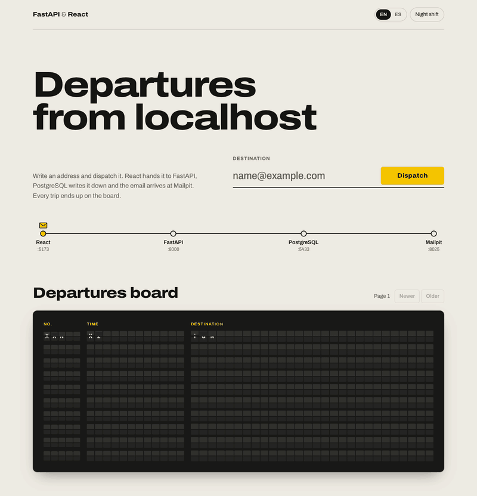

<div align="center">

# FastAPI · React Fullstack Template

**A ready-to-code development template: FastAPI backend, React frontend, PostgreSQL, Redis and Mailpit, all started with one command.**

[](https://github.com/davidcastillocruz/FastAPI-React-Template/actions/workflows/ci.yml)
[](LICENSE)




[Features](#features) · [Quick start](#quick-start) · [Starting a project](#starting-a-project) · [Working with Claude Code](#working-with-claude-code) · [Project structure](#project-structure) · [Backend guide](#backend-guide) · [Frontend guide](#frontend-guide) · [Testing](#testing) · [Useful commands](#useful-commands) · [Conventions](#conventions) · [Known limitations](#known-limitations)

</div>

---

## Overview

The template comes with the plumbing every project ends up needing (configuration, logging, translated errors, languages, themes, rate limiting, emails, tests and CI) already built, reviewed and tested, plus one complete example feature to copy from.

The example is a small demo, **"Departures from localhost"**: you write an email address, React sends it to FastAPI, PostgreSQL saves it and a styled test email arrives at Mailpit. Every request shows up on a split-flap departures board.

> [!NOTE]
> This is a **development** template. There is no production setup on purpose (no production compose, no reverse proxy, no secrets management), and there is no user or authentication module: the only feature is the demo.

## Features

### Backend

- **Validated settings** with pydantic-settings: every variable is required, a missing or wrong value stops the app on startup, and validation errors never print secret values.
- **Async database** with SQLAlchemy 2 and asyncpg, a naming convention for constraints, and **Alembic** migrations applied automatically on startup.
- **Translated errors**: every error of the API answers `{"detail": "..."}` in the user's language (404, 405, 422, 429, 500 and your own), and the OpenAPI docs show the real shape.
- **Language system**: `?lang=` > `language` cookie > `Accept-Language` > default. Translation files are checked on startup (missing languages, different keys, wrong placeholders, repeated keys).
- **Structured logging**: one line per log with a request id and the client IP, extras as `key=value`, emails masked when sending, control characters escaped, colors in the terminal. Every response carries an `X-Request-ID` header (except CORS preflights, which the CORS middleware answers before the request reaches the app).
- **Rate limiting** with slowapi, counters in Redis (with an in-memory fallback), named limits shared by the routes, and a test that fails if a route has no limit.
- **Body size limit**: a request body over 1 MB gets a translated 413, also when it doesn't say its size, before FastAPI reads it whole.
- **Background emails** with fastapi-mail, caught by Mailpit in development. Every email shares one HTML layout with inline styles, and its texts are translated and escaped.
- **Tests** with pytest against a real PostgreSQL test database.
- **Lint and types** with ruff and pyright: modern syntax, sorted imports, trailing commas, lines up to 120 characters and type checking in standard mode, both checked in CI.

### Frontend

- **React 19 + Vite 8** in JavaScript, React Router and imports from `src` with the `@` alias.
- **Theme system**: light and dark themes as CSS variables. Follows the system live until the user picks one, saved in a cookie, applied before the first render.
- **Language system**: same languages and cookie as the backend, so the API always answers in the language of the page. `useT()` translates with named placeholders and checks every translation file in development.
- **Axios instance** with a timeout that sends the cookies, so the backend's errors arrive in the language of the page.
- **Validated settings**: `VITE_` variables, required like the backend's. A missing or wrong `VITE_API_URL` stops the dev server, the build and the tests.
- **Component packages**: every page and component lives in its own folder with its JSX, CSS module, translations (when it has text of its own) and tests.
- **Tests** with Vitest, jsdom and Testing Library.

### Tooling

- **Docker Compose** for the whole stack, with hot reload in the backend and the frontend.
- **GitHub Actions**: backend tests, migrations check, lint and type check, frontend lint, tests and build on every push.

## Tech stack

| Layer | Tools |
| --- | --- |
| Backend | Python 3.14, FastAPI, Pydantic, SQLAlchemy 2 (async), Alembic, slowapi, fastapi-mail |
| Frontend | React 19, Vite 8, React Router, axios, CSS modules, oxlint |
| Services | PostgreSQL 17, Redis 8, Mailpit |
| Testing | pytest, pytest-asyncio, httpx · Vitest, jsdom, Testing Library |
| Tooling | Docker Compose, GitHub Actions, ruff, pyright |

## Quick start

**Requirements:** [Docker](https://www.docker.com/) with Docker Compose. Everything, tests included, runs inside the containers.

```bash
git clone https://github.com/davidcastillocruz/FastAPI-React-Template.git
cd FastAPI-React-Template
```

There are no env files in the repository, not even examples. Create the two of them with the values for Docker (git ignores them):

```bash
cat > backend/.env.api <<'EOF'
APP_TITLE=FastAPI-React-Template
APP_DESCRIPTION=A fullstack development template
APP_MODE=development
DATABASE_HOST=db
DATABASE_PORT=5432
DATABASE_POOL_SIZE=5
DATABASE_MAX_OVERFLOW=10
RATE_LIMIT_STORAGE_URI=redis://redis:6379
CORS_ORIGINS=http://localhost:5173
MAIN_LANGUAGE=en
AVAILABLE_LANGUAGES=en,es
MAIL_USERNAME=fastapi@react.dev
MAIL_PASSWORD=password
MAIL_FROM=fastapi@react.dev
MAIL_SERVER=mailpit
MAIL_PORT=1025
MAIL_START_TLS=false
MAIL_SSL_TLS=false
EOF

cat > backend/.env.db <<'EOF'
POSTGRES_USER=postgres
POSTGRES_PASSWORD=1234
POSTGRES_DB=app
EOF
```

Start everything and open the services:

```bash
docker compose up --build
```

| Service | URL |
| --- | --- |
| Web | http://localhost:5173 |
| API docs (Swagger) | http://localhost:8000/docs |
| Mailpit (sent emails) | http://localhost:8025 |
| PostgreSQL (from a database client) | `localhost:5433` |

Open the web at `localhost`, not `127.0.0.1`: `localhost:5173` is the origin allowed in `CORS_ORIGINS`, from any other one every call to the API is blocked.

Saving a file reloads the API (`backend/src`) or the page (`frontend/src`). Two things are only read when the backend starts, the migrations and the translation files: after adding one or changing one, run `docker compose restart backend`.

## Starting a project

[`STARTING.md`](STARTING.md) takes you from this template to a new project: create the repository, take the demo out file by file, name the project and choose its languages, put in your design, build the first page and the first module, and make [`CLAUDE.md`](CLAUDE.md) your project's.

## Working with Claude Code

[`CLAUDE.md`](CLAUDE.md) is what makes [Claude Code](https://claude.com/claude-code) work on this code the way it was written: Claude reads it by itself when it starts in the repository, so there is nothing to paste. It holds the conventions of each layer, how to name things, what has to be checked before calling something done and how commits are written. The rule that comes first is that the code that exists is the convention: Claude copies the closest case and asks before bringing in a new pattern.

Keep it committed and alive in your project:

- Say in it what is specific to your project (its modules, its decisions), next to what comes from the template.
- When you settle a new convention, write it down there in the same change: what isn't in that file doesn't reach the next session.
- If it stops matching the code, the code wins and the file gets fixed.

## Project structure

```
.
├── backend/
│   ├── src/
│   │   ├── main.py              # app, request logging middleware, CORS, routers
│   │   ├── core/                # settings, logger, request context, languages, errors, limiter, shared translations
│   │   ├── api/                 # dependencies (Language, client IP) and one router per module
│   │   ├── modules/             # features: models, schemas, repositories, services, translations
│   │   ├── mail/
│   │   │   ├── sender.py        # send_email, run in the background
│   │   │   ├── layout.py        # render_email: the HTML of every email
│   │   │   ├── emails.py        # one function per email: its texts and what it shows
│   │   │   └── translations/    # the texts of every email
│   │   ├── database/
│   │   │   ├── base.py          # Base, with the naming convention of constraints
│   │   │   ├── session.py       # async engine, get_db, DbSession
│   │   │   └── models.py        # imports every model for SQLAlchemy and Alembic
│   │   └── shared/schemas.py    # MessageResponse {message}, ErrorResponse {detail}
│   ├── alembic/                 # env.py and the migration template
│   │   └── versions/            # one file per migration
│   ├── tests/
│   ├── ruff.toml                # lint rules
│   └── pyrightconfig.json       # type checker settings
├── frontend/
│   └── src/
│       ├── main.jsx             # providers and every route
│       ├── index.css            # global styles
│       ├── themes/              # theme variables, provider and useTheme
│       ├── languages/           # language provider, useLanguage and useT
│       ├── utils/               # api (axios) and cookies
│       ├── pages/               # one folder per page
│       ├── components/          # one folder per shared component
│       ├── hooks/               # shared hooks
│       ├── features/            # big features with their own pages, components and hooks
│       └── test/                # setup of the frontend tests
├── docs/                    # the GIF of this README
├── CLAUDE.md                # how to work on the code, read by Claude Code
├── STARTING.md              # from the template to a new project
├── LICENSE
├── .github/workflows/ci.yml
└── docker-compose.yml
```

Folders that only hold a `.gitkeep` (`frontend/src/hooks/`, `frontend/src/features/`) are part of the structure on purpose: they are where that code goes once it exists. The `.gitkeep` goes away with the first file.

## Backend guide

### Adding a module

Each feature is a module in `backend/src/modules/<module>/`, split in layers. Use `modules/demo/` as the reference. A request goes router → service → repository: the repository only talks to the database and returns ORM models, the service holds the logic, commits once at the end of its flow, raises the `HTTPException`s and returns Pydantic schemas, and the router returns what the service gives.

1. **Model** in `models/`, inheriting from `Base` (`src/database/base.py`), then import it in `src/database/models.py`. Without that import Alembic doesn't see the table and `--autogenerate` creates an empty migration. Class names are singular (`EmailRequest`), table names plural (`email_requests`).
2. **Migration**: generate it, review the file in `alembic/versions/` and apply it with `docker compose restart backend`.
   ```bash
   docker compose exec backend alembic revision --autogenerate -m "create users"
   ```
   On Linux with Docker Engine the container creates the file as root, so you can't edit it without `sudo`. Run it as your user instead (Docker Desktop on macOS and Windows doesn't need it):
   ```bash
   docker compose exec -u "$(id -u):$(id -g)" backend alembic revision --autogenerate -m "create users"
   ```
3. **Schemas** in `schemas/`: what the endpoints receive and return.
4. **Repository** in `repositories/`: only database queries, no `try/except` (closing the session rolls back) and never a commit, a test checks it.
5. **Service** in `services/`: the logic, with one `await db.commit()` at the end of the flow. Catch only foreseeable errors and turn them into an `HTTPException`, the rest becomes a translated 500.
6. **Translations** in `translations/<name>_translations.json`: every one inside `src/` is loaded on startup (see [Errors and translations](#errors-and-translations)).
7. **Router** in `src/api/routers/`, included in `main.py`. Every route has one of the limits of `src/core/limiter.py` (`READ_LIMIT`, `EMAIL_LIMIT`...), never a number of its own: a new kind of action adds its constant there.
8. **Tests** in `backend/tests/`, with a row for each route in `test_limiter.py`.

### Errors and translations

Translation files hold every text in every language, with `%s` placeholders:

```json
{
    "USER_NOT_FOUND": {
        "en": {
            "detail": "User %s doesn't exist"
        },
        "es": {
            "detail": "El usuario %s no existe"
        }
    }
}
```

```python
raise HTTPException(
    status_code=status.HTTP_404_NOT_FOUND,
    detail=get_error_detail("USER_NOT_FOUND", language, {"detail": (username,)}),
)
```

Successful responses that only carry a message use `MessageResponse` (`{"message": "..."}`), and every error answers `{"detail": "..."}`. When the same error is raised in several places, a helper builds and returns the `HTTPException` and the call site raises it (see `_already_requested` in the demo service).

The backend refuses to start when a translation file is invalid JSON, repeats a key or a response name, misses a language of `AVAILABLE_LANGUAGES`, has different text keys or a different number of `%s` in each language, or has a literal `%` next to a `%s` (write it `%%`). The log line of the error names the file and the entry.

### Logging

```python
logger = logging.getLogger(__name__)
logger.info("Email request saved", extra={"email_request_id": email_request.id})
```

The request id and the client IP are added to every line automatically. Keep the message fixed, put the data in `extra`, and never log personal data.

### Configuration

Every setting lives in `src/core/settings.py` and is **required**. A new setting goes in `Settings`, in `backend/.env.api` (or `backend/.env.db` if PostgreSQL uses it too), in the block of the quick start, in `env` of `.github/workflows/ci.yml` and in `VALID` in `backend/tests/test_settings.py`: the settings tests ignore the `.env` files and only use the values listed there.

Docker reads the `.env` files only when it creates the containers: after changing a value, run `docker compose up -d` (a restart keeps the old values). The `POSTGRES_*` values only create the user and the database the first time; to change them later, run `docker compose down -v`, which deletes the data of the database.

## Frontend guide

### Settings

The frontend's settings are `VITE_` variables, required like the backend's: today only `VITE_API_URL`, the address of the backend the browser calls. They live in the `environment` of the `frontend` service of `docker-compose.yml` and in the `env` of the frontend job of `ci.yml`, never in a `.env` file. `vite.config.js` checks them (`checkSettings`): a missing or wrong one stops the dev server, the build and the tests with a message that names it. Vite writes them into the code when it builds, so after changing one run `docker compose up -d frontend`.

### Adding a page or a component

Every page and component is a folder with everything it needs:

```
pages/ProfilePage/
├── ProfilePage.jsx
├── ProfilePageStyle.module.css
├── ProfilePageTranslation.json   # only if it has text of its own
└── ProfilePage.test.jsx
```

Pages are registered in `src/main.jsx`:

```jsx
const router = createBrowserRouter([
  { path: '/', element: <HomePage /> },
  { path: '/profile', element: <ProfilePage /> },
  { path: '*', element: <NotFoundPage /> },
]);
```

Keep the `*` route: it shows `NotFoundPage` for any other path.

Where the folder goes:

- `src/components/`: a piece used by several pages (a button, a field).
- `src/pages/`: a page on its own (the home page, the 404).
- `src/features/<area>/`: a big feature with several pages, components and hooks of its own (`features/auth/pages/LoginPage/`, `features/auth/components/LoginForm/`). What only that feature uses stays inside it; what two features share moves up to `components/` or `hooks/`.

The rest of the rules (accessibility, animations, tests) are in the *Frontend* section of [`CLAUDE.md`](CLAUDE.md).

### Translations

```json
{ "greeting": { "en": "Hello {name}", "es": "Hola {name}" } }
```

```jsx
import { useT } from '@/languages/useT';

import translations from './ProfilePageTranslation.json';

const t = useT(translations);
t('greeting', { name: 'Ana' });
```

`const { language, setLanguage } = useLanguage()` reads or changes the language without reloading the page.

To add a language, add it to `AVAILABLE_LANGUAGES` in `backend/.env.api` and in the block of the quick start, to `LANGUAGES` in `frontend/src/languages/languages.js`, and to every translation file of the backend and the frontend (the backend doesn't start while one is missing it). Keep `MAIN_LANGUAGE` the same on both sides.

### Themes

The variables of `src/themes/themes.css` work in any CSS module without importing anything:

```css
.card {
  background: var(--color-surface);
  color: var(--color-text);
}
```

`const { theme, setTheme } = useTheme()` reads or changes the theme. A new variable goes in both themes.

### Calling the API

```js
import { api } from '@/utils/api';

try {
  const { data } = await api.post('/users', { email });
} catch (error) {
  const detail = error.response?.data?.detail;
  if (typeof detail === 'string') {
    // The backend's message, already translated
    setError(detail);
  } else {
    // An answer without a detail (a proxy's error page...) or no answer at all (backend down, timeout)
    setError(t(error.response ? 'unexpected' : 'noConnection'));
  }
}
```

## Testing

```bash
docker compose exec backend pytest     # backend, against its own test database
docker compose exec frontend npm test  # frontend
```

The linters and the type checker, the same ones CI runs:

```bash
docker compose exec backend ruff check        # backend lint (ruff check --fix fixes most of it)
docker compose exec backend pyright           # backend types
docker compose exec frontend npm run lint     # frontend lint
```

### Without Docker

The tests also run on your computer, the same way CI runs them. The backend needs Python 3.14, the `.env` files of the quick start and the `db` container (or any PostgreSQL) running; the frontend needs Node 24.

```bash
cd backend
python3.14 -m venv .venv && source .venv/bin/activate
pip install -r requirements.txt
DATABASE_HOST=localhost DATABASE_PORT=5433 pytest
ruff check . && pyright
```

```bash
cd frontend
npm ci
export VITE_API_URL=http://localhost:8000
npm test && npm run lint && npm run build
```

The backend tests create and use an `app_test` database in the same PostgreSQL, so your development data is never touched. `docker compose exec frontend npx vitest` keeps the frontend tests running while you code.

The backend tests always run with `en` as the main language and `en`, `es` available (forced in `tests/conftest.py`), whatever your `.env.api` says. The frontend's language tests follow `MAIN_LANGUAGE` and `LANGUAGES` of `src/languages/languages.js`.

### Continuous integration

On every push and pull request, GitHub Actions runs three jobs in parallel:

- **Backend tests**: `alembic upgrade head` and `alembic check` (a model changed without its migration fails), then pytest against a PostgreSQL 17 service.
- **Backend lint and types**: ruff with the rules of `backend/ruff.toml` and pyright with `backend/pyrightconfig.json`.
- **Frontend**: oxlint, Vitest and the production build.

## Useful commands

| Task | Command |
| --- | --- |
| Start everything | `docker compose up --build` |
| Stop everything | `docker compose down` |
| Backend logs | `docker compose logs -f backend` |
| New migration | `docker compose exec backend alembic revision --autogenerate -m "..."` (on Linux, see [Adding a module](#adding-a-module)) |
| Apply the migrations | `docker compose restart backend` |
| Undo the last migration | `docker compose exec backend alembic downgrade -1` (then delete or edit its file in `alembic/versions/`: the backend runs `alembic upgrade head` every time it starts) |
| Add a frontend dependency | `docker compose exec frontend npm install <package>` |
| Reinstall the frontend dependencies of the container (after a pull that changes `package.json`) | `docker compose up --build -V` |
| Tests, lint and types | See [Testing](#testing) |

## Conventions

- **Language**: code, comments and commit messages in English; texts for the user in the translation files (`*_translations.json` in the backend, `*Translation.json` in the frontend), with the same keys and placeholders in every language and the Spanish texts addressing the user as "tú". The only texts outside them are names like FastAPI or React and the English title and description of `index.html`, shown before the JavaScript loads.
- **Names**: backend files in `snake_case`, one per concept (`email_request_repository.py`), modules in singular (`modules/demo/`). Frontend components and pages in a `PascalCase` folder with `Name.jsx`, `NameStyle.module.css`, `NameTranslation.json` and `Name.test.jsx`; systems and utilities in `camelCase` (`themes/`, `languages/`, `cookies.js`).
- **Imports, backend**: standard library, third party, then `src`, one blank line between groups. ruff (`I` rules) enforces it.
- **Imports, frontend**: packages (alphabetically, so `axios` goes before `react`), then `@/` imports, then relative ones (in a component, `./NameStyle.module.css` and `./NameTranslation.json`), one blank line between groups and never `../`.
- **Format**: backend with double quotes, trailing commas and 120 characters per line (ruff); frontend with single quotes. There is no formatter, follow the surrounding code.
- **Comments**: above the line they explain, saying why rather than what, descriptive and without first person. No commented-out code and no `TODO` without context.
- **Commits**: one per change, conventional commits with a broad title and a short visual description by sections. The format and the rest of the conventions of each layer are in [`CLAUDE.md`](CLAUDE.md).
- **CSS**: colors from the variables of `themes.css` (only neutral shadows, highlights and the edge of the dark board are written as `rgb()` or `white`), one CSS module per component, `clamp()` for fluid sizes (headings, page spacing), `px` for the rest of the text.
- **Ignores**: every `# noqa`, `# pyright: ignore[...]` and `// oxlint-disable-next-line` in the code is needed (each one was checked by removing it and running the tool). Remove one only after checking that the tool stays green without it.

## Known limitations

- **Only from your computer**: every port of `docker-compose.yml` is published on `127.0.0.1`. To open the web from another device, publish the ports of `frontend` and `backend` without `127.0.0.1:`, set `VITE_API_URL` to the backend's address as that device sees it, and add the web's origin to `CORS_ORIGINS`; opened by a name and not an IP, Vite also needs that name in `server.allowedHosts` of `vite.config.js`. The Mailpit link of the demo (`frontend/src/pages/HomePage/HomePage.jsx`) is written as `http://localhost:8025`.
- **Rate limit per IP**: the limit is per client IP as the backend sees it. Behind a reverse proxy every user would share the proxy's IP, unless that IP is in `FORWARDED_ALLOW_IPS`: uvicorn then takes the client's from `X-Forwarded-For`. In Docker every request from your computer arrives from the gateway of the Docker network (like `172.18.0.1`), so all your browser tabs share one counter.
- **Offset pagination**: a request saved between two page loads moves the next page one row, so a row can show twice. The order itself is stable (newest first, ties broken by id).
- **Dependency audit** (2026-11-05): OSV reports nothing for the 221 packages pinned in `requirements.txt` and `package-lock.json`.
- **slowapi on Python 3.14**: pytest shows a `DeprecationWarning` from slowapi (`asyncio.iscoroutinefunction`). It comes from the library and doesn't affect the app until Python 3.16.

## License

[MIT](LICENSE): use it, change it and ship it, keeping the copyright notice.

---

<div align="center">

Made by [@davidcastillocruz](https://github.com/davidcastillocruz)

</div>
